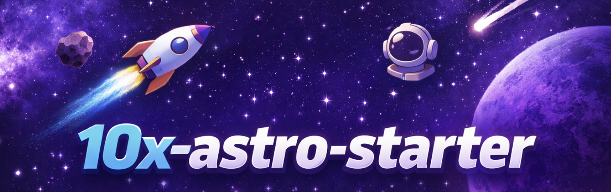

# 10x Astro Starter



A modern, opinionated starter template for building fast, accessible web applications.

## Tech Stack

- [Astro](https://astro.build/) v6 - Modern web framework with server-first rendering
- [React](https://react.dev/) v19 - UI library for interactive components
- [TypeScript](https://www.typescriptlang.org/) v5 - Type-safe JavaScript
- [Tailwind CSS](https://tailwindcss.com/) v4 - Utility-first CSS framework
- [Supabase](https://supabase.com/) - Authentication and backend-as-a-service
- [Cloudflare Workers](https://workers.cloudflare.com/) - Edge deployment runtime

## Prerequisites

- Node.js v22.14.0 (as specified in `.nvmrc`)
- npm (comes with Node.js)

## Getting Started

1. Clone the repository:

```bash
git clone https://github.com/przeprogramowani/10x-astro-starter.git
cd 10x-astro-starter
```

2. Install dependencies:

```bash
npm install
```

3. Set up Supabase and configure environment variables — see [Supabase Configuration](#supabase-configuration) below.

4. Create a `.dev.vars` file for local Cloudflare dev secrets:

```bash
cp .env.example .dev.vars
```

5. Run the development server:

```bash
npm run dev
```

## Available Scripts

- `npm run dev` - Start development server (Cloudflare workerd runtime)
- `npm run build` - Build for production
- `npm run preview` - Preview production build
- `npm run lint` - Run ESLint with type-checked rules
- `npm run lint:fix` - Auto-fix ESLint issues
- `npm run format` - Run Prettier

## Project Structure

```md
.
├── src/
│ ├── layouts/ # Astro layouts
│ ├── pages/ # Astro pages
│ │ └── api/ # API endpoints
│ ├── components/ # UI components (Astro & React)
│ └── assets/ # Static assets
├── public/ # Public assets
├── wrangler.jsonc # Cloudflare Workers config
```

## Supabase Configuration

This project uses [Supabase](https://supabase.com/) for authentication. Environment variables are declared via Astro's `astro:env` schema and are treated as **server-only secrets** — they are never exposed to the client.

### First-time setup (local, no cloud project needed)

Requires [Docker](https://www.docker.com/) and ~7 GB RAM.

1. Create your `.env` file:

```bash
cp .env.example .env
```

2. Initialize the local Supabase project (creates a `supabase/` config folder):

```bash
npx supabase init
```

3. Start the local stack (downloads Docker images on first run):

```bash
npx supabase start
```

4. Copy the credentials printed by the CLI into your `.env` and `.dev.vars`:

```
SUPABASE_URL=http://127.0.0.1:54321
SUPABASE_KEY=<anon key from CLI output>
```

5. To stop the stack when done:

```bash
npx supabase stop
```

The local Studio UI is available at `http://localhost:54323`.

ToySwapper v2 ships schema migrations under `supabase/migrations/`. After `supabase start`, apply them with `npx supabase db reset`. See the next section for the migration workflow and [`supabase/README.md`](supabase/README.md) for the RLS contract every user-scoped table follows.

### Using a cloud Supabase project instead

If you prefer to use a hosted Supabase project, add these variables to your `.env` and `.dev.vars` files:

| Variable       | Description                                                |
| -------------- | ---------------------------------------------------------- |
| `SUPABASE_URL` | Project URL from Supabase dashboard → Settings → API       |
| `SUPABASE_KEY` | `anon` public key from Supabase dashboard → Settings → API |

```
SUPABASE_URL=https://<project-ref>.supabase.co
SUPABASE_KEY=<anon-key>
```

### Working with migrations

Schema lives in `supabase/migrations/`. Conventions and the RLS policy template are documented in [`supabase/README.md`](supabase/README.md) — read it before adding a new table.

```bash
# Apply all migrations + seeds from an empty schema
npx supabase db reset

# Lint a draft migration (catches syntax errors and warnings)
npx supabase db lint

# Run the pgTAP suite (added in F-01 Phase 2)
npx supabase test db
# or:  npm run db:test
```

In CI, every PR runs `db lint` and `test db`; merges to `master` additionally run `supabase db push` against the production Supabase project (added in F-01 Phase 3 — required repo secrets documented there).

### Email confirmation in local development

By default Supabase requires email confirmation before a user can sign in. To skip this during local development:

1. Open the Supabase dashboard for your project
2. Go to **Authentication → Email → Confirm email**
3. Toggle it **off**

Users can then sign in immediately after sign-up without clicking a confirmation link.

### Auth routes

| Route                 | Description                                                             |
| --------------------- | ----------------------------------------------------------------------- |
| `/auth/signin`        | Email/password sign-in form                                             |
| `/auth/signup`        | Email/password sign-up form                                             |
| `/auth/confirm-email` | Post-signup "check your inbox" page                                     |
| `/dashboard`          | Example protected page (redirects to `/auth/signin` if unauthenticated) |

Route protection is handled in `src/middleware.ts`. Add paths to the `PROTECTED_ROUTES` array there to require authentication.

## Deployment

This project deploys to [Cloudflare Workers](https://workers.cloudflare.com/).

1. Build the project:

```bash
npm run build
```

2. Deploy with Wrangler:

```bash
npx wrangler deploy
```

Set `SUPABASE_URL` and `SUPABASE_KEY` as secrets in your Cloudflare dashboard or via `npx wrangler secret put`.

## CI

GitHub Actions runs two parallel jobs on every push and PR to `master`:

- **`ci`** — `lint + build`. Requires `SUPABASE_URL` and `SUPABASE_KEY` repository secrets for the build step.
- **`db`** — boots a local Postgres (`supabase db start`), runs `supabase db lint --level warning` and `supabase test db` (the pgTAP RLS suite). On pushes to `master` only, it then runs `supabase db push --linked` to apply pending migrations to the production Supabase project **before** any deploy.

### Repository secrets for the `db push` step

The migration-push step needs three additional GitHub Actions secrets. **Set them before the next merge to `master`, or the `db push` step will fail and block deploys:**

| Secret                  | Description                                                                                       |
| ----------------------- | ------------------------------------------------------------------------------------------------- |
| `SUPABASE_PROJECT_REF`  | The prod project's ref (the `<project-ref>` in its dashboard URL / `*.supabase.co` hostname).     |
| `SUPABASE_ACCESS_TOKEN` | A personal access token from <https://supabase.com/dashboard/account/tokens>.                     |
| `SUPABASE_DB_PASSWORD`  | The prod project's database password, set during project provisioning.                            |

## License

MIT
