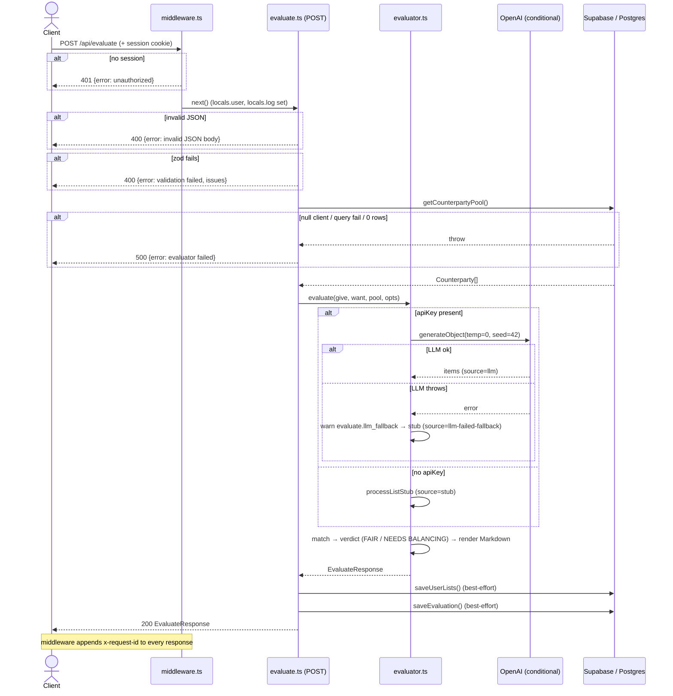

# Research: Core Evaluation Pipeline

> **Evidence convention.** **EVIDENCE** = read directly from source/tests/git (file:line).
> Key load-bearing claims (determinism seed, LLM-fallback branch, test stub) were
> **spot-verified first-hand**; remaining file:line refs come from sub-agent source reads.
> **INFERENCE** = deduction. **UNKNOWN** = not verifiable from static analysis.
> Scope: analysis only — **no production code was modified.**

## Feature overview

The evaluation feature is ToySwapper's core action: an authenticated `POST /api/evaluate`
turns an operator's freeform give/want lists into a deterministic Markdown barter contract
with a fairness verdict, persists the result, and returns it on the wire.

- **Entry handler:** `src/pages/api/evaluate.ts` (88 lines — EVIDENCE: `wc -l`). Thin
  orchestrator: validate → load pool → call engine → persist (best-effort) → serialize.
- **Engine:** `src/lib/evaluator.ts` (416 lines — EVIDENCE: `wc -l`). The
  standardize → value → match → fairness → render pipeline, with a three-way processing
  strategy: **LLM** (`gpt-4o-mini`, `temperature: 0`, `seed: 42` — EVIDENCE: evaluator.ts:142-143),
  **deterministic stub** (regex/keyword classifier), or **LLM-failed-fallback** (stub after a
  caught LLM error).
- **Determinism contract (PRD-locked):** identical inputs → byte-identical Markdown. Enforced
  via `temperature: 0` + `seed: 42` for the LLM path and a pure stub otherwise
  (EVIDENCE: evaluator.ts:142-143; `source` union evaluator.ts:169).
- **Auth:** gated by middleware — anonymous `POST /api/evaluate` → HTTP 401 JSON
  (EVIDENCE: middleware.ts:47-48).

---

## 1. Trace E2E (data flow)

### Request lifecycle (POST /api/evaluate)

| #   | Stage                                                                         | Evidence                 | Notes                                                           |
| --- | ----------------------------------------------------------------------------- | ------------------------ | --------------------------------------------------------------- |
| 1   | Auth gate → 401 if no `locals.user`                                           | middleware.ts:43-50      | `{"error":"unauthorized"}`, status 401, `x-request-id` header   |
| 2   | Request-bound logger (request_id, route, user_id)                             | middleware.ts:33-38      | attached to `locals.log`                                        |
| 3   | JSON parse → 400 on failure                                                   | evaluate.ts:24-29        | `{"error":"invalid JSON body"}`                                 |
| 4   | Zod validation (`give` min1, `want` min1, `threshold_pct` 1–99 optional)      | evaluate.ts:14-18, 32-38 | `{"error":"validation failed","issues":[…]}`                    |
| 5   | Threshold resolution (defaults to `FAIRNESS_THRESHOLD_PCT`)                   | evaluate.ts:40           | env-driven default (PRD OQ-3: v1=20%)                           |
| 6   | Supabase client (`createClient`); null if env absent                          | evaluate.ts:44           | reads `SUPABASE_URL`/`KEY` via `astro:env/server`               |
| 7   | Load counterparty pool (`getCounterpartyPool`)                                | evaluate.ts:45           | throws → 500 if null client / query fail / 0 rows               |
| 8   | Engine: `evaluate(give, want, pool, {apiKey, baseURL, thresholdPct, logger})` | evaluate.ts:46-51        | see processing-strategy below                                   |
| 9   | Persist user lists (best-effort)                                              | evaluate.ts:58-63        | failure logged `user_lists.save_failed`, does NOT block         |
| 10  | Persist history (best-effort)                                                 | evaluate.ts:68-72        | failure logged `evaluation_history.save_failed`, does NOT block |
| 11  | 200 JSON `EvaluateResponse`                                                   | evaluate.ts:75-78        | `content-type: application/json`                                |
| 12  | catch → 500 (RLS-denial classified via `isRlsDenied`)                         | evaluate.ts:79-87        | `{"error":"evaluator failed","message":<msg>}`                  |

### Processing-strategy decision (LLM vs stub vs fallback)

- `preferLLM = Boolean(opts.apiKey)` (EVIDENCE: evaluator.ts:380).
- **Stub** when `!(preferLLM && apiKey)` → `source: "stub"` (EVIDENCE: evaluator.ts:172-176).
- **LLM** when key present: `processListLLM` (EVIDENCE: evaluator.ts:186) → `source: "llm"`.
- **Fallback** on LLM throw: catch → `logger.warn("evaluate.llm_fallback")` → stub →
  `source: "llm-failed-fallback"` (EVIDENCE: evaluator.ts:189-198).
- Results cached per `(source::text)` key (EVIDENCE: evaluator.ts:181-195). INFERENCE: the
  `source` of the **give** list is what the response reports; the want-list source is computed
  but not surfaced (evaluator.ts:382).

### Wire responses (complete set)

| Status         | Body                                                                     | Evidence             |
| -------------- | ------------------------------------------------------------------------ | -------------------- |
| 200            | `{contract, counterparty_id, verdict, delta_pln, threshold_pct, source}` | evaluate.ts:75-78    |
| 200 (no-match) | same shape, `counterparty_id/verdict/delta_pln = null`                   | evaluator.ts:386-394 |
| 400            | `{error:"invalid JSON body"}`                                            | evaluate.ts:26-29    |
| 400            | `{error:"validation failed", issues:[…]}`                                | evaluate.ts:34-37    |
| 401            | `{error:"unauthorized"}`                                                 | middleware.ts:47-50  |
| 500            | `{error:"evaluator failed", message:<msg>}`                              | evaluate.ts:83-86    |

### Sequence diagram

---

## 2. Test gaps

**Framework:** Vitest (EVIDENCE: package.json). **Critical setup fact:** the test stub forces
`OPENAI_API_KEY = undefined` (EVIDENCE: test/stubs/astro-env-server.ts:6), so `preferLLM` is
**always false** in tests → **the entire LLM and fallback code path is unreachable by the suite.**

Test files: `test/evaluate.test.ts` (139 lines, mocks the engine, tests the handler),
`test/determinism.test.ts` (33 lines, real engine, **stub path only**), `test/middleware.test.ts`
(covers the 401) — EVIDENCE: `wc -l`, sub-agent reads.

| Branch / state                                           | Covered?                         | Evidence                               |
| -------------------------------------------------------- | -------------------------------- | -------------------------------------- |
| 200 happy path                                           | ✅                               | evaluate.test.ts:68-80                 |
| 500 generic evaluator error                              | ✅                               | evaluate.test.ts:82-92                 |
| 500 RLS-denied (`isRlsDenied`/42501)                     | ✅                               | evaluate.test.ts:94-103                |
| 401 unauthenticated API                                  | ✅                               | middleware.test.ts:69-79               |
| FAIR / NEEDS BALANCING / NO-MATCH verdicts               | ✅                               | determinism.test.ts (snapshot cases)   |
| `saveEvaluation` failure (best-effort)                   | ✅                               | evaluate.test.ts:128-138               |
| Stub path (no key)                                       | ✅ (only because stub is forced) | determinism.test.ts + stub:6           |
| **400 invalid JSON**                                     | ❌ EXPOSED                       | evaluate.ts:24-29 has no test          |
| **400 zod validation fail**                              | ❌ EXPOSED                       | evaluate.ts:32-38 has no negative test |
| **LLM success path (`source:"llm"`)**                    | ❌ EXPOSED                       | unreachable — key forced undefined     |
| **LLM-failed-fallback (`source:"llm-failed-fallback"`)** | ❌ EXPOSED                       | evaluator.ts:189-198 never exercised   |
| **`saveUserLists` failure**                              | ❌ EXPOSED                       | evaluate.ts:58-63 catch untested       |
| Balancing-suggestion logic                               | ⚠️ indirect                      | evaluator.ts:261-283 only via snapshot |
| `threshold_pct` boundary (0/1/99/100)                    | ❌ EXPOSED                       | no boundary tests                      |

**Highest-risk exposed gaps (ranked):**

1. **LLM-failed-fallback path** — production-only (key present), completely untested; a bug here degrades silently to stub or could throw. EVIDENCE: evaluator.ts:189-198 + stub:6.
2. **LLM success path / determinism under real LLM** — the `temperature:0,seed:42` byte-identity guarantee is **never tested against an actual LLM** (only the stub is). EVIDENCE: stub:6, determinism.test.ts.
3. **400 input-validation paths** (invalid JSON + zod) — untested despite being user-facing. EVIDENCE: evaluate.ts:24-38.
4. **`saveUserLists` failure** — silent data loss breaks FR-016 restore; untested. EVIDENCE: evaluate.ts:58-63.

UNKNOWN: whether the module-level `processedCache` (evaluator.ts:160) is reset between
determinism test cases — possible cross-case cache bleed not verified.

---

## 3. Blast radius

### Static (EVIDENCE: `grep` over src/)

- **`evaluator.ts` fan-in:** 1 production importer — `evaluate.ts:5` — plus 2 tests
  (evaluate.test.ts, determinism.test.ts). `grep -rn "from.*evaluator" src/` → 1 src hit.
- **`evaluator.ts` fan-out:** external `ai`, `@ai-sdk/openai`, `zod`; internal `@/types`,
  `@/lib/log` (evaluator.ts:1-14).
- **`evaluate.ts` fan-in:** 0 production (API route — graph root); 1 test import.
- **`evaluate.ts` fan-out (6):** `@/lib/evaluator`, `@/lib/supabase`, `@/lib/counterparties`,
  `@/lib/user-lists`, `@/lib/evaluation-history`, `@/lib/log` (evaluate.ts:1-10). Highest
  fan-out non-page module in the repo (corroborates repo-map Z1).
- **Type-contract reach:** `EvaluateResponse` flows engine → `evaluation-history.ts` (persist)
  → `history.astro` (read-back). Changing its shape silently corrupts persisted history.

### Historical co-change (EVIDENCE: `git log --name-only`)

- `evaluator.ts` touched in **3** commits; `evaluate.ts` in **5**; **3 shared** (every
  evaluator change also touched the handler → 100% co-change on the engine side).
- Co-changed with the engine: `counterparties.ts` (×2), `test/determinism.test.ts` (×1 + its
  snapshot), `test/evaluate.test.ts`. Consistent with repo-map's `evaluator.ts ⇄ evaluate.ts`
  (×3) coupling pair.

### Verdict

- **Directly coupled (change together):** `evaluator.ts ↔ evaluate.ts` (signature/return/side
  effects) and `evaluator.ts ↔ types.ts` (`EvaluateResponse`, `ProcessedList`, `Verdict`,
  `Counterparty`).
- **At-risk:** both test suites (signature mock + determinism snapshots), `counterparties.ts`
  (pool ordering must not regress or determinism breaks).
- **Moderate (indirect):** `history.astro` + `evaluation-history.ts` — read/persist
  `EvaluateResponse`; field add/remove/rename leaks into stored history (PRD: stored Markdown
  must stay byte-identical, so only additive-safe changes are acceptable).
- **Safe:** `user-lists.ts`, auth routes, `supabase.ts`, `log.ts` — orthogonal.

---

## Technical debt

| #   | Debt                                                                               | Severity      | Evidence                                              | Why it matters                                                                                                                                                                  |
| --- | ---------------------------------------------------------------------------------- | ------------- | ----------------------------------------------------- | ------------------------------------------------------------------------------------------------------------------------------------------------------------------------------- |
| TD1 | **LLM + fallback paths have zero test coverage**                                   | High          | stub:6, evaluator.ts:186-198                          | The production-only code (real key) is the least-tested; a regression in the determinism-critical LLM path or its fallback ships unnoticed.                                     |
| TD2 | **Determinism guarantee untested against a real LLM**                              | High          | determinism.test.ts (stub-only), evaluator.ts:142-143 | The PRD-locked byte-identity contract is only verified for the stub; `temperature:0,seed:42` is asserted by inspection, not test.                                               |
| TD3 | **Input-validation branches (400s) untested**                                      | Medium        | evaluate.ts:24-38                                     | User-facing error contracts can regress (status/shape) silently.                                                                                                                |
| TD4 | **`evaluate.ts` is a coupling + churn hub (fan-out 6)**                            | Medium        | evaluate.ts:1-10; co-change ×3                        | Highest blast radius in the repo; orchestration + persistence + error classification all in one handler. INFERENCE: push more into the (independent) lib services to shrink it. |
| TD5 | **`source` of want-list silently dropped; response reports give-list source only** | Low           | evaluator.ts:382                                      | A mixed llm/stub run could mislabel `source`; minor observability debt.                                                                                                         |
| TD6 | **`saveUserLists` failure path untested**                                          | Low–Med       | evaluate.ts:58-63                                     | Silent FR-016 (list restore) breakage.                                                                                                                                          |
| TD7 | **Possible `processedCache` bleed across tests**                                   | Low (UNKNOWN) | evaluator.ts:160                                      | If not reset, determinism snapshots could pass/fail for the wrong reason.                                                                                                       |

**Net read (INFERENCE):** the pipeline is well-structured and deterministic _by construction_,
but its riskiest surface — the real-LLM path, its failure fallback, and input validation — is
exactly where test coverage is absent. The engine is tightly bound to its handler and to
`EvaluateResponse`; any signature/shape change is a coordinated, high-blast-radius edit.

## Limits of this analysis (UNKNOWN / not covered)

- **No code executed** and **no real LLM call made** — LLM behavior (latency ≤5s NFR,
  actual determinism under load) is unverified.
- File:line refs outside the spot-verified set come from sub-agent source reads (2026-06-11
  working tree); they were not each re-opened by hand.
- **RLS / service-role-key correctness** is a runtime/SQL concern (`supabase/README.md` +
  pgTAP), out of scope here.
- Coverage percentages are branch-presence judgments, not instrumented coverage
  (no `vitest --coverage` run).
