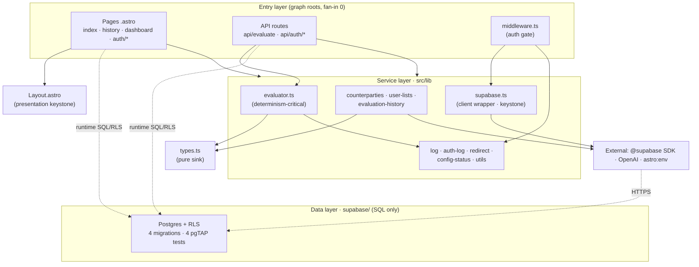

# ToySwapper — Repo Map (onboarding canonical)

> Module 4 · Lesson 2: Project Mapping · Compiled 2026-06-11 · Branch: master
> Synthesis of: [Artifact 1 — Territory](artifact-1-territory.md),
> [Artifact 2 — Structure](artifact-2-structure.md),
> [Artifact 3 — Contributors](artifact-3-contributors.md).
>
> **Reading convention:** every claim is tagged.
> **EVIDENCE** = hard data from CLI/scripts (paths, counts, verified import chains).
> **INFERENCE** = architectural deduction from that data.
> **UNKNOWN** = blanks, runtime-only behavior, unverified boundaries.

---

## 1. TL;DR

ToySwapper is an Astro 6 SSR app (React 19 islands, Tailwind 4) on Cloudflare Workers that turns two parents' freeform give/want lists into a deterministic Markdown barter contract with an LLM-estimated fairness verdict, gated behind Supabase auth with RLS-scoped persistence (**EVIDENCE:** PRD + `package.json` + `src/` graph). The codebase is small and young — **36 source files, 55 internal import edges, 0 circular dependencies** — and strictly layered: pages/API → `src/lib` services → `src/types.ts` (**EVIDENCE:** Artifact 2). Its two structural keystones are `src/lib/supabase.ts` (the data/auth client, fan-in 7) and `src/layouts/Layout.astro` (the page shell, fan-in 6) (**EVIDENCE:** fan-in counts). The single highest-risk file is `src/pages/api/evaluate.ts` — the most-churned code file _and_ the most-coupled module (fan-out 6), orchestrating five lib services (**EVIDENCE:** Artifacts 1+2). The actual data layer lives in `supabase/` as 4 SQL migrations + 4 pgTAP tests — no JS/TS — so its correctness is enforced in SQL, not crawlable by the import graph (**EVIDENCE:** `find supabase`). The whole repo is the work of **one human maintainer** (under two git identities) with Claude as an AI pair, so the durable "expert" is the `context/` decision trail, not a team (**EVIDENCE:** Artifact 3). Development is after-hours and accelerating (19 → 24 → 37 commits/week) (**EVIDENCE:** Artifact 1).

_(INFERENCE: the dotted edges to Postgres are runtime data-flow, not import edges — the import graph cannot see them; see Ograniczenia.)_

---

## 2. Teren (territory)

**High-responsibility folders** (EVIDENCE: churn from Artifact 1, fan-in from Artifact 2):

| Folder               | Why it's load-bearing                                                                                     | Signal                                       |
| -------------------- | --------------------------------------------------------------------------------------------------------- | -------------------------------------------- |
| `src/lib`            | Business logic + data access; holds both keystone (`supabase.ts`) and determinism-critical `evaluator.ts` | dir-churn 17; fan-in hub                     |
| `src/pages/api`      | The gated evaluate endpoint — product's core action                                                       | `evaluate.ts` = top code churn + top fan-out |
| `supabase/`          | The RLS data contract; correctness enforced in SQL                                                        | dir-churn high; 4 migrations + 4 tests       |
| `context/foundation` | PRD/roadmap/conventions — the decision spine                                                              | **#1 churned path** (roadmap touched 9×)     |
| `test/`              | 10+ specs co-evolving with `src/lib`                                                                      | dir-churn 17, concentrated in week W24       |

**Peripheral / low-responsibility** (INFERENCE):

- `src/components/ui/*` (shadcn primitives) — stable, low churn.
- `src/components/Welcome.astro`, `src/components/ui/LibBadge.astro` — **orphan/dead** (EVIDENCE: fan-in 0, referenced nowhere; Artifact 2 R2).
- `src/layouts`, `src/styles` — presentational, stable.

**Weekly velocity** (EVIDENCE: Artifact 1):

| ISO week | Commits | Focus                                                  |
| -------- | ------- | ------------------------------------------------------ |
| 2026-W22 | 19      | RLS baseline, seed pool, logging foundations           |
| 2026-W23 | 24      | auth gate (S-01), restore lists (S-02), UX polish      |
| 2026-W24 | 37      | evaluation-history, testing campaign, context refactor |

INFERENCE: monotonic acceleration + a clean Jun 4–7 gap = an after-hours solo cadence ramping toward v2 completion, not a stalling project.

---

## 3. Realne powiązania (true coupling)

**Co-change coupling** (EVIDENCE: files committed together ≥3× over full history):

| Pair                                                           | Times together | Meaning                                          |
| -------------------------------------------------------------- | -------------- | ------------------------------------------------ |
| `src/lib/evaluator.ts` ⇄ `src/pages/api/evaluate.ts`           | 3              | The endpoint and its core engine move as a unit. |
| `context/changes/structured-logging-baseline/{change,plan}.md` | 3              | Methodology artifact pair — not code.            |

EVIDENCE: no other file pair crosses the ≥3 threshold → the repo is **genuinely loosely
coupled at the commit level**; there is no tangled cluster of files that always change together.

**Static coupling that matters** (EVIDENCE: Artifact 2 fan-out):
`api/evaluate.ts` imports 6 internal modules (evaluator + counterparties + user-lists +
evaluation-history + supabase + log). INFERENCE: it is the single integration point of the
product's core action — change it carefully.

**Layer breaches:** **none found** (EVIDENCE: grep for `src/lib` importing
pages/components/layouts returned nothing; DFS found 0 cycles). INFERENCE: the layered
architecture is currently intact, not aspirational.

UNKNOWN: co-change coupling between `src/` and `supabase/migrations/*.sql` is not meaningfully
measurable yet — the data layer changes via new immutable migrations, so historical co-change
under-represents the real runtime dependency of `evaluate.ts`/data helpers on the schema.

---

## 4. Strefy ryzyka (risk zones)

| #   | Zone                                             | One-line why                                                                                                 |
| --- | ------------------------------------------------ | ------------------------------------------------------------------------------------------------------------ |
| Z1  | `src/pages/api/evaluate.ts`                      | EVIDENCE: top churn + top fan-out (6) — highest blast radius in the repo.                                    |
| Z2  | `src/lib/supabase.ts`                            | EVIDENCE: keystone fan-in 7 — one edit ripples to middleware, every auth route, evaluate, and 2 pages.       |
| Z3  | `supabase/` RLS contract                         | INFERENCE: a wrong policy silently leaks every user's rows; correctness is SQL-only and import-invisible.    |
| Z4  | Determinism boundary (`evaluator.ts` + LLM call) | EVIDENCE: PRD-locked byte-identical-output rule; INFERENCE: easy to break via an unseeded/uncached LLM path. |
| Z5  | Bus factor = 1                                   | EVIDENCE: single human maintainer (Artifact 3) — no human redundancy if unavailable.                         |
| Z6  | Orphan/dead components                           | EVIDENCE: `Welcome.astro` + `ui/LibBadge.astro` unreferenced — low severity, but they mislead onboarding.    |

---

## 5. Kogo zapytać (who to ask)

EVIDENCE (Artifact 3): there is **one human** — Michał Zasiadczuk
(`m.zasiadczuk.98@gmail.com`), also appearing as the day-1 machine identity `Michal_MAC`. The
practical "expert" per zone is the documented decision trail.

| Risk zone            | Ask                 | Durable source of truth                                                                  |
| -------------------- | ------------------- | ---------------------------------------------------------------------------------------- |
| Z1 evaluate endpoint | Michał Zasiadczuk   | `context/archive/2026-05-31-gated-evaluator/`, `…feature-evaluation-history/`            |
| Z2 supabase keystone | Michał Zasiadczuk   | `src/lib/CLAUDE.md`, `supabase/README.md`                                                |
| Z3 RLS contract      | Michał Zasiadczuk   | `supabase/README.md` + pgTAP tests in `supabase/tests/`                                  |
| Z4 determinism       | Michał Zasiadczuk   | `context/foundation/conventions.md` (PRD-locked rules), `context/foundation/prd.md` §NFR |
| Z5 bus factor        | — (no human backup) | The whole `context/` methodology trail is the redundancy.                                |
| Z6 dead code         | Michał Zasiadczuk   | git blame (day-1 starter leftovers)                                                      |

INFERENCE: onboarding here means reading `context/`, not interviewing people — the repo was
built AI-paired and spec-first, so rationale lives in plans/PRD, not in colleagues' heads.

---

## 6. Pierwszy dzień (first-day reading list)

Ordered for a new engineer; read top-to-bottom (EVIDENCE: all paths verified to exist):

1. `context/foundation/prd.md` — what the product is and the locked invariants.
2. `context/foundation/conventions.md` — the canonical repo-wide rules (determinism, RLS, fairness).
3. `context/foundation/roadmap.md` — what's done vs proposed; the v1→v2 arc.
4. `src/pages/api/evaluate.ts` — the core action; the hottest, most-coupled file (Z1).
5. `src/lib/evaluator.ts` — the determinism-critical standardize→value→match→fairness→Markdown pipeline.
6. `src/lib/supabase.ts` + `src/middleware.ts` — the auth/data keystone and the gate (Z2).
7. `supabase/README.md` — the RLS data contract every table follows (Z3).
8. `context/map/repo-map.md` — this file, for the whole-territory overview.

---

## 7. Ograniczenia (limits — what this map does NOT cover)

- **Time window:** full history = **2026-05-29 → 2026-06-11 (~2 weeks, 80 commits)**. "12 months"
  captured everything; a **quarterly** trend is degenerate (single bucket Q2 2026) — weekly is the
  only honest granularity (EVIDENCE: Artifact 1).
- **Import graph is `src/`-only and static.** It cannot see: runtime SQL/RLS calls into Postgres,
  `astro:env` virtual modules, dynamic/string-built imports, or Cloudflare Workers bindings
  (UNKNOWN).
- **`supabase/` is not in the structural graph** — it's SQL, not JS/TS. RLS/service-role-key
  correctness is verified by pgTAP + `supabase/README.md`, **not** by this map (UNKNOWN here).
- **No SVG / rendered graph** generated yet (deferred per the lesson plan; tabular data first).
- **Determinism, ≤5s latency, and the RLS multi-account guarantee are runtime properties** — this
  map locates _where_ they live but does not test them (UNKNOWN: not exercised here).
- **Contributor analysis collapses two identities into one human** and discards AI co-authors;
  it is ownership-by-authorship, not a competence or availability assessment (INFERENCE).
- **`.astro` imports were parsed by a bespoke regex**, not a full Astro compiler — exotic import
  syntaxes could be missed (low risk; UNKNOWN).
